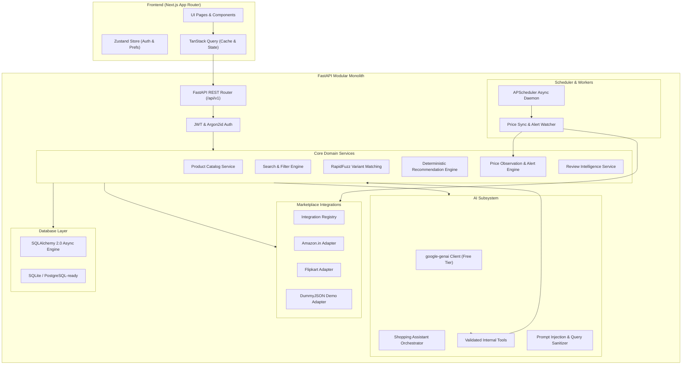

# PriceWise Architecture Documentation

## 1. Overview
PriceWise is a high-performance, AI-powered electronics price comparison and shopping intelligence platform tailored for the Indian consumer electronics market.

The platform follows a **Modular Monolith** architecture:
- Independent frontend (Next.js 14+ App Router, TypeScript, Tailwind CSS, TanStack Query, Zustand)
- Independent backend (FastAPI, Python 3.11+, SQLAlchemy 2.0 Async, Pydantic v2)
- Zero external API expenditure (Free Google Gemini tier with `gemini-3.5-flash-lite`, legal marketplace scraping with respectful rate limiting, and comprehensive built-in catalog data)

## 2. Component Design & Boundaries

### A. Marketplace Integration Layer (`backend/app/integrations/`)
- Isolated behind `BaseMarketplaceAdapter`
- Standard normalized response format: `MarketplaceProduct` and `MarketplaceOffer`
- Independent state tracker per adapter (`AVAILABLE`, `DEGRADED`, `RATE_LIMITED`, `UNAVAILABLE`)
- Conservative rate limiting and automatic exponential backoff

### B. Product Matching & Deduplication Engine (`backend/app/intelligence/matching/`)
- Tokenizes and cleans product titles (brand removal, regex extraction of RAM/Storage/Color/Model Number)
- Calculates similarity using RapidFuzz (token set ratio, partial ratio)
- Enforces strict variant differentiation: Never conflates different storage/RAM tiers

### C. Recommendation Engine (`backend/app/intelligence/ranking/`)
- Deterministic, explainable scoring model (0-100)
- Configurable weights: Price (35%), Specifications (30%), Rating (20%), Review Volume (10%), Value/Discount (5%)
- Dynamic category-specific attribute weights (e.g. CPU/GPU for laptops, camera/battery for smartphones)

### D. Gemini AI Assistant (`backend/app/ai/`)
- Powered by `google-genai` SDK on `gemini-3.5-flash-lite`
- Controlled tool calling against internal backend services
- Strict guardrails: No SQL execution, no code execution, zero hallucination of fake prices/products
