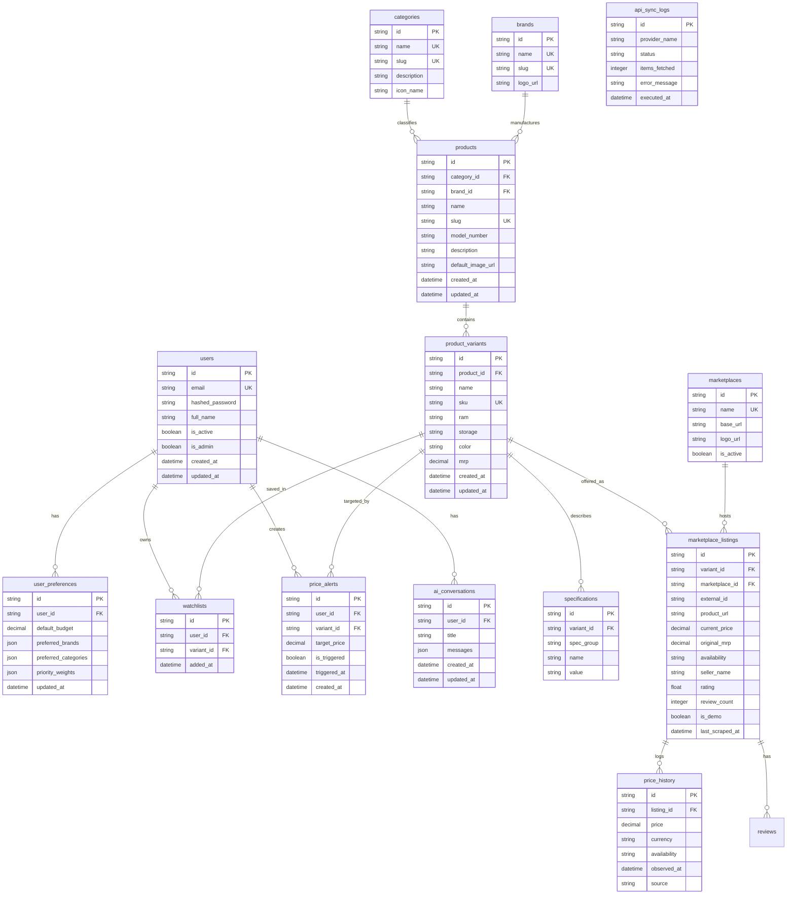

# PriceWise Database Schema Documentation

The PriceWise database design uses **SQLAlchemy 2.0 Async** with a SQLite local file and is 100% **PostgreSQL-ready** (UUID primary keys, UTC ISO timestamps, Decimal monetary values, foreign key integrity, and explicit indexes).

## Entities & Relationships

## Schema Invariants & Design Principles
1. **Append-Only Price Observations**: Old price records in `price_history` are **NEVER overwritten or mutated**. Every sync appends an observation.
2. **Strict Variant Isolation**: `marketplace_listings` map to a specific `product_variants` entity (e.g. 256GB / 12GB RAM), never directly to a generic product entity.
3. **Demo Transparency**: `is_demo` flag is explicitly propagated from listings up to search and details view models.
